# Check_Steam-Link V1.8.8

<div align="center">

[](https://opensource.org/licenses/AGPL3.0)
-lightblue)
[](README.md)
[](https://github.com/inori-3333/astrbot_plugin_steamshot/graphs/contributors)
[](https://github.com/inori-3333/astrbot_plugin_steamshot/commits/main)

</div>

<div align="center">

[](https://github.com/inori-3333/astrbot_plugin_steamshot)

</div>

+ 一个AstrBot插件。A plugin for AstrBot.
> 如果您觉得对您有用，请点一个star，我会学猫娘叫。
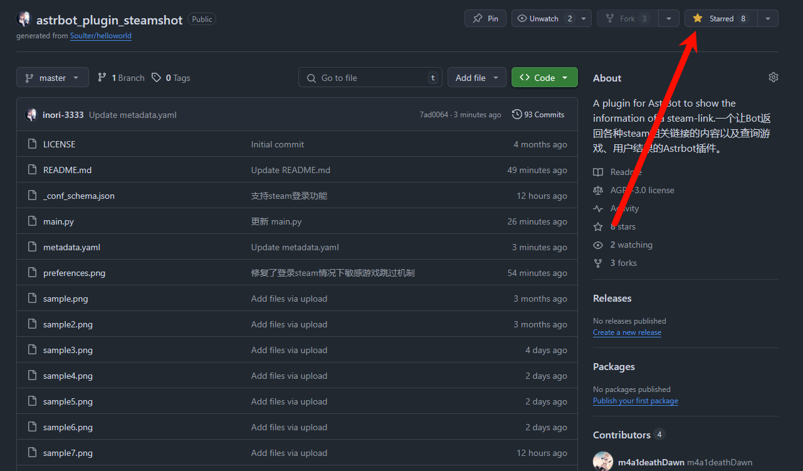
> 当前版本：v1.8.8

# 功能介绍
## 已实现
自动检测对话中出现的如下内容，并返回对应页面的网页截图和摘要信息：
- steam商店页链接
- steam个人主页链接
- steam创意工坊链接
- 单条消息中最多自动处理 3 个 Steam 链接

  目前支持的格式如下：
```
https://store.steampowered.com/app/881020/Granblue_Fantasy_Relink/ # 游戏商店页链接
https://steamcommunity.com/id/inori_333/ # 个人主页链接
https://steamcommunity.com/sharedfiles/filedetails/?id=3472726693 # 创意工坊物品链接
```
可解析的信息：
```
steam商店界面:
游戏名称
发行时间
开发商
发行商
游戏类别（保留前五个）
游戏简介
游戏评分
游戏价格
是否支持中文（包括简体中文和繁体中文）
当前在线人数
DLC数量
历史低价、当前多商店低价、近期 Steam 价格变动（需 IsThereAnyDeal API Key，近期价格需 detailed 摘要）

steam个人资料界面:
用户名称
封禁记录
个人简介
steam等级
地区
当前状态
游戏数
好友数
最新动态
好友在线概览（需 Steam Web API Key 且好友列表公开）

steam创意工坊界面:
游戏名称
创意工坊作品名称
作者名称
作者主页链接
作者状态
评分
文件大小
创建日期
更新日期
标签
描述
```
## 待实现
- 图形化价格曲线、价格提醒等更完整价格能力（当前已支持通过 IsThereAnyDeal 查询历史低价、当前多商店低价，detailed 摘要下可展示近期 Steam 价格变动）。

# 使用方法
## 软件依赖
程序依赖无头浏览器进行本地截屏，支持如下运行方式：
- Windows / Linux 本机：Chrome 或 Chromium
- Docker：amd64 默认使用 Google Chrome，arm64 默认使用 Chromium

程序会按以下顺序解析浏览器与驱动：
1. 环境变量指定
2. 系统已安装路径
3. `webdriver-manager` 自动下载（可关闭）

## 第三方库依赖
程序依赖以下第三方库：
- selenium
- webdriver-manager
- requests
- beautifulsoup4
- jinja2

AstrBot 插件目录下请提供 `requirements.txt`，由 AstrBot 统一安装依赖。

## Docker 快速启动（x86_64 + arm64）
仓库已提供 `docker/Dockerfile` 与 `docker-compose.yml`，默认持久化 `./data` 并挂载当前插件目录。

```bash
docker compose build --no-cache
docker compose up -d
```

默认行为：
- `amd64`: 安装 Google Chrome
- `arm64`: 安装 Chromium + Chromium Driver（自动回退策略）
- 插件挂载路径：`/AstrBot/data/plugins/astrbot_plugin_steamshot`
- 持久化路径：`./data:/AstrBot/data`

可选环境变量（均可不填）：
- `STEAMSHOT_BROWSER_BIN`：浏览器可执行文件路径
- `STEAMSHOT_CHROMEDRIVER_BIN`：Chromedriver 可执行文件路径
- `STEAMSHOT_BROWSER_KIND`：`auto|chrome|chromium`（默认 `auto`）
- `STEAMSHOT_SKIP_WDM`：`1/0`，`1` 表示禁用 `webdriver-manager` 下载
- `STEAMSHOT_DATA_DIR`：插件数据目录（默认 `./data/plugins/astrbot_plugin_steamshot`）

常见排障：
- 容器日志若出现 `无法解析 ChromeDriver`，请检查浏览器/驱动是否安装，或显式设置 `STEAMSHOT_CHROMEDRIVER_BIN`
- ARM64 下若未安装 Chromium，请确认镜像构建时 `TARGETARCH=arm64` 并重新 build
- 页面截图失败时可先确认容器 `shm_size` 是否足够（本仓库默认 `1gb`）

## 自动检测使用示例
_以下两个示例为v1.0.0版本，当前使用效果请查看更新日志中新的示例。_
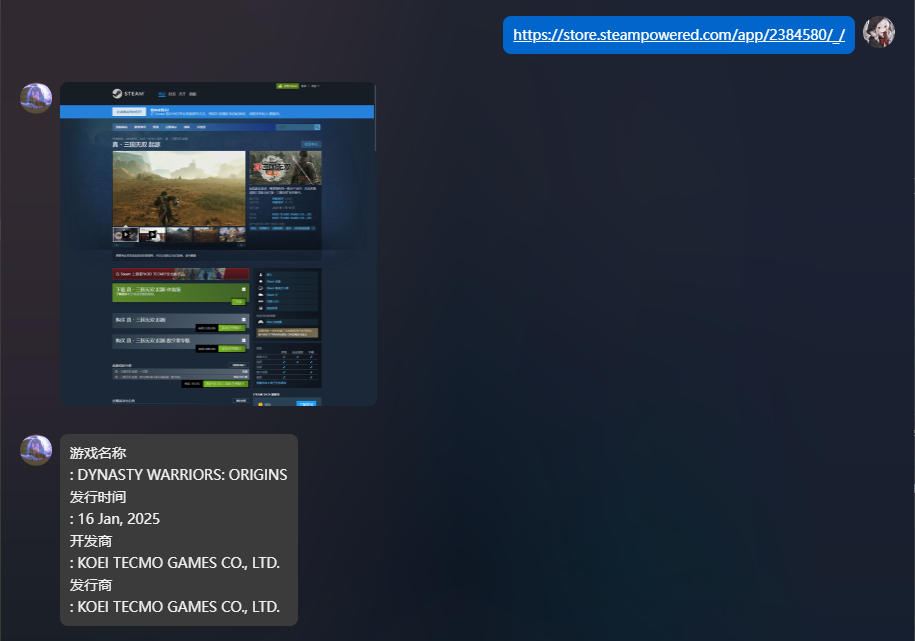
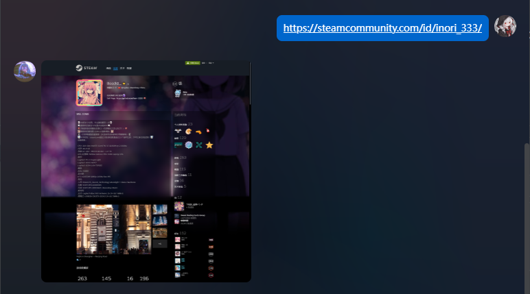

## 指令使用指南
根据收到的steam链接自动解析指定界面，插件会自动检测对话中出现的steam链接，并返回对应页面的网页截图和摘要信息（现仅支持steam商店界面、个人主页界面和创意工坊界面）。
```
使用  /sss  指令搜索steam商店，使用方法: /sss + 游戏名，如: /sss 不/存在的你，和我
使用  /ssu  指令搜索steam用户，使用方法: /ssu + 用户名，如: /ssu m4a1_death-Dawn
```
搜索结果支持翻页：回复 `n` / `下一页` 查看下一页，回复 `p` / `上一页` 返回上一页；回复序号进入对应详情页。

用户搜索翻页示例：
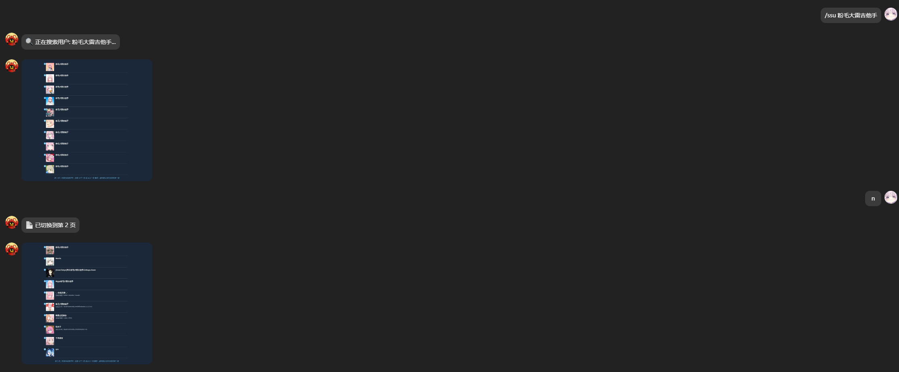

选择用户后，个人主页基础摘要与好友在线概览示例：
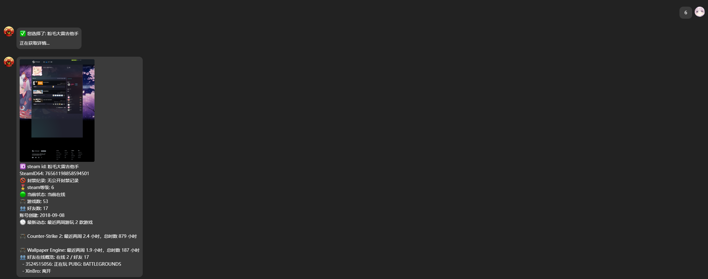

商店搜索示例：
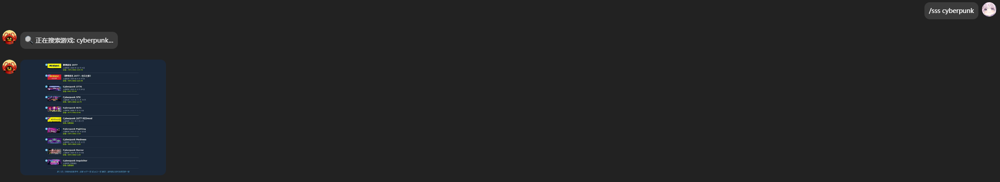

选择游戏后，商店摘要与历史低价、当前低价示例：
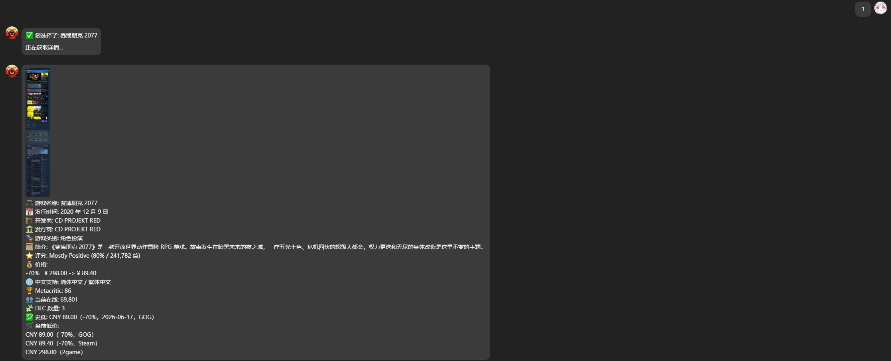

## 可配置项
插件配置中支持以下运行参数：
- `use_steam_api`：商店页和个人主页摘要优先使用 Steam 官方 API，失败时自动回退网页解析
- `steam_api_key`：可选，个人主页 API 摘要和好友状态解析需要填写；商店页无需填写
- `show_friends`：是否在个人主页摘要中追加好友在线概览，需 Steam Web API Key 且目标好友列表公开
- `friends_status_limit`：好友在线概览最多展示多少位在线/游戏中的好友，默认 `10`
- `show_price_history`：是否在商店页摘要中追加历史低价，需 IsThereAnyDeal API Key
- `itad_api_key`：可选，用于查询历史低价
- `itad_country`：IsThereAnyDeal 查询价格时使用的国家/地区代码，默认 `CN`
- `price_current_limit`：当前多商店低价展示数量，默认 `3`
- `price_history_limit`：`detailed` 摘要下近期 Steam 价格变动展示数量，默认 `5`
- `return_screenshot`：是否返回截图，关闭后只返回文字摘要以减少耗时
- `screenshot_width`：截图宽度，默认 `1440`
- `screenshot_max_height`：截图最大高度，默认 `20000`，用于避免超长页面生成过大图片
- `screenshot_scroll_limit`：懒加载滚动次数上限，默认 `15`
- `summary_detail_level`：摘要详细程度，支持 `simple` / `standard` / `detailed`
- `cache_ttl_store`：商店摘要缓存秒数，默认 `1800`，`0` 表示禁用
- `cache_ttl_profile`：个人主页摘要缓存秒数，默认 `300`，`0` 表示禁用
- `cache_ttl_workshop`：创意工坊摘要缓存秒数，默认 `600`，`0` 表示禁用

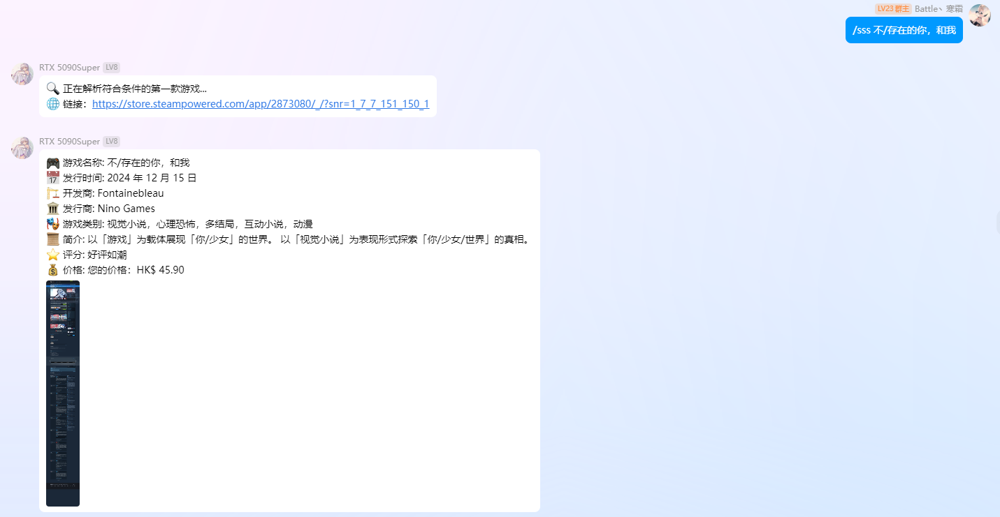
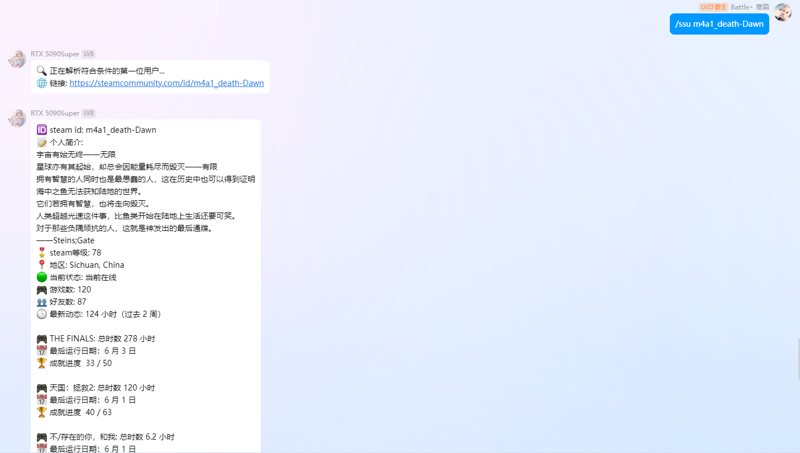

```
使用  /ssl  指令进行steam登录操作，具体使用方法：
  /ssl enable - 启用steam登录功能
  /ssl disable - 禁用steam登录功能
  /ssl status - 查看当前登录状态
  /ssl store [cookies文本] - 设置Steam商店cookies
  /ssl community [cookies文本] - 设置Steam社区cookies
  /ssl test - 测试Steam登录状态
```

注意**steam商店和steam社区的cookies要分开设置**，steam商店的域名对应steampowered.com，steam社区的域名对应steamcommunity.com，**两者cookies不能通用**  

**获取cookies的方法**：打开浏览器 - 进入steam网页登录你的steam账号 - （按F12）调出开发者工具 - 选择网络/Network选项 - 进入一个steam网页 - 选择名称排在最上面那个项 - 右边那个标头/header里面向下拉 - 找到请求标头/request header项 - 把其中的cookies复制  

这只是一种获取steam cookies的方法，其他还有很多方法，但最好填写完整的cookies，只填写部分的cookies可能会报错  
这就是你的cookies，请保存好，不要泄露，通过指令的方式或者填入Astrbot网页图形ui中插件管理 - Check Steam-Link 插件配置栏中的 input 输入框中  

**安全提醒：cookies 内的 `steamLoginSecure` 等字段相当于短期登录凭据，请不要公开截图或日志；建议使用单独账号配置插件。**

插件会将 Cookie 配置框作为密码框展示，并在本地保存 `auth/steam_cookies.json` 时尽力收紧认证目录与文件权限、采用原子写入减少异常中断导致的文件损坏。权限保护不能替代账号隔离，仍不建议在公共机器上保存主账号 Cookie。

**强烈建议您在获取steam cookies前，配置好您的偏好设置，避免搜索时出现不必要的bug**
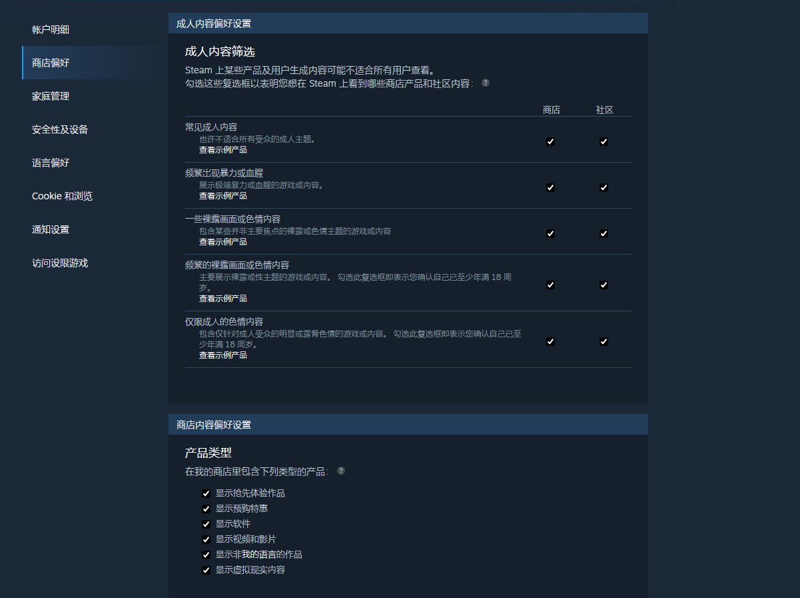

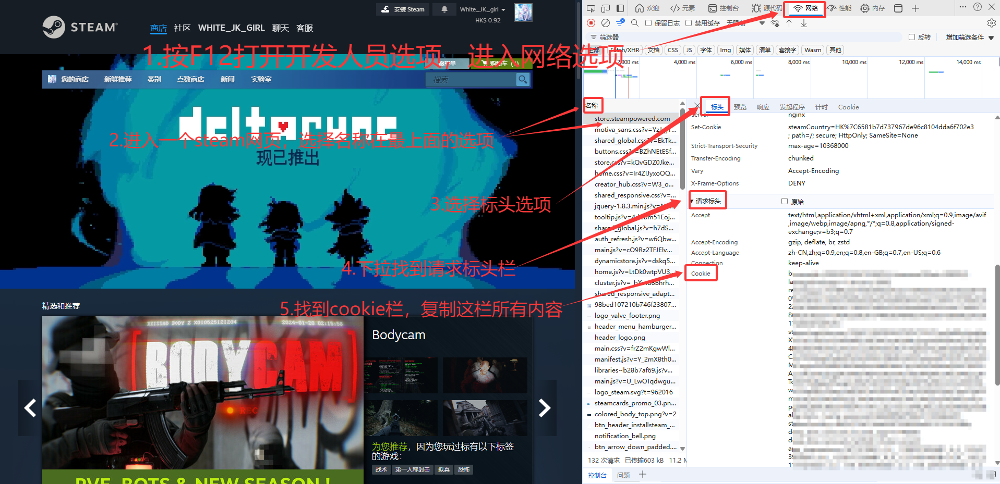
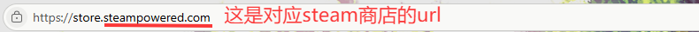
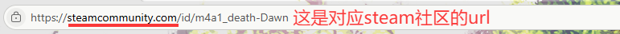
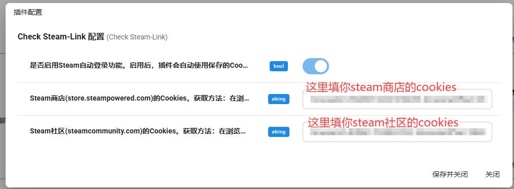
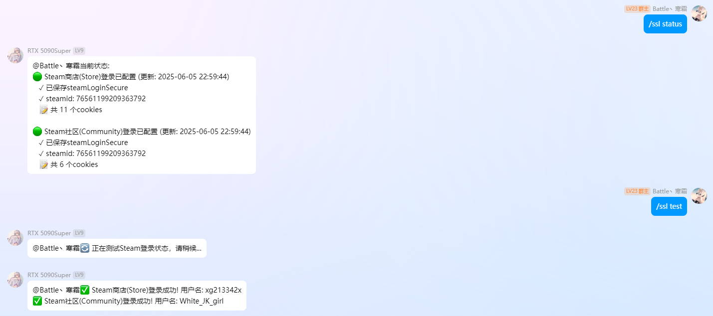

**注意：当你进入的是前缀为steampowered.com的steam网页时，对应的cookies是steam商店cookies；当你进入的是前缀为steamcommunity.com的网页时，对应的cookies是steam社区的cookies。请不要填错**  

# 已知问题

+ 使用steam登录功能时，cookies有效期只有差不多48小时，48小时后需要更换cookies，猜测是48小时刷新一次cookies，现阶段无法解决，等后续适配steam web api方案
+ 未配置 Steam Web API Key 时，个人主页仍以网页解析为主，可能会返回```⚠️ 无法获取个人主页部分信息 + 个人主页截图```，再试1-2次通常可恢复；配置 API Key 后会优先使用官方 API 获取基础摘要
+ 使用/sss和/ssu指令时返回```❌ 搜索失败: 502, message='Attempt to decode JSON with unexpected mimetype: ', url='https://t2i.soulter.top/text2img/generate'```重试1-2次即可正常使用
> 如果有其他问题，请提issue，并附上报错原因，你的系统版本和python版本

# 更新记录
## v1.2.0
+ 对steam个人主页链接的监听（返回个人主页截图）
+ 对游戏商店页内容更详细的解析（返回文本）

## v1.3.0
+ 修复了发行商异常换行
+ 自动获取ChromeDriver
+ 异步运行，防止因网络原因卡死astrbot，失败时自动重试

## v1.4.0
+ 修复了打折游戏价格无法正常显示的bug
+ 支持steam网页完整截图

## v1.4.5
+ 支持绕过steam年龄验证界面

## v1.5.0
+ 新增支持steam主页解析功能

## v1.6.0
+ 新增支持steam创意工坊解析功能
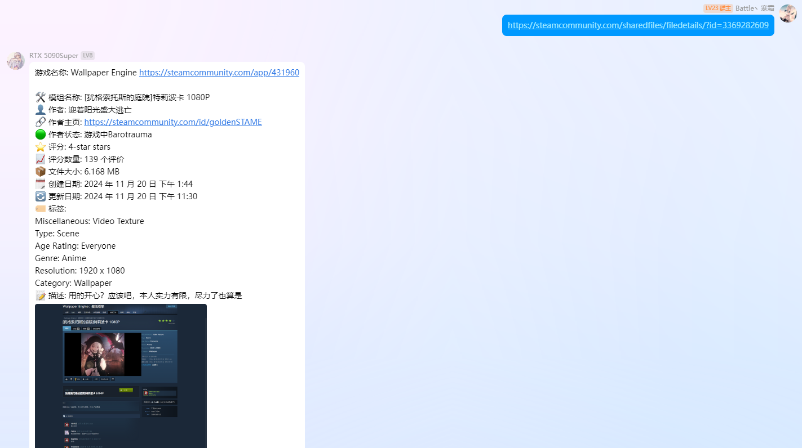

## v1.6.1
+ 支持解析steam主页最新动态，并改善排版
+ 支持解析steam个人简介中的链接（之前考虑到可能会有些不良链接，不过现在还是觉得应该问题不大，还是放出来了）
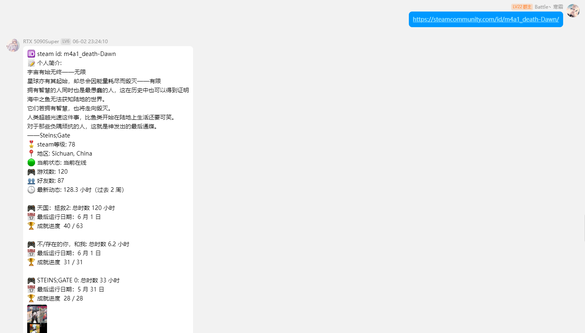

## v1.6.3
+ 新增支持steam个人主页封禁记录解析
+ 修复了chrome自动更新导致的chromedriver版本不匹配的问题，如果控制台返回chromedriver版本不匹配，重载插件即可解决

## v1.6.5
+ 修复了steam创意工坊解析的bug
+ 完善Steam创意工坊链接处理功能

## v1.7.0
+ 新增搜索steam商店和搜索steam用户指令

## v1.8.0
+ 新增支持通过保存cookies的方式登录steam（注意：steam商店和steam社区两个的cookies不一样，请不要填错了）

## v1.8.1
+ 修复了登录状态下steam商店敏感游戏验证无法跳过的问题
+ 修复了登录状态下steam商店可能有些游戏搜不到的问题

## v1.8.2
+ 优化了steam商店界面价格部分的解析

## v1.8.5
+ 支持搜索商店和用户时从符合条件的前10项中选择的功能
+ 修复了免费游戏和预购游戏价格可能无法解析的问题

## v1.8.6
+ 修复了低版本python可能会因为{}内包裹的`\`发生`f-string`类型语法错误的问题

## v1.8.7
+ 新增 Docker 运行支持（x86_64 + arm64）
+ 新增跨平台浏览器/驱动探测逻辑（环境变量 > 系统路径 > webdriver-manager）
+ 修复 Linux 环境导入 `winreg` 导致插件启动失败的问题

### v1.8.8
+ 修复元信息与主程序中的版本
+ 新增CHANGELOG.md和logo.png

### v1.9.0
+ 优化 Steam 页面渲染流程，减少重复启动浏览器与重复加载页面
+ 商店页摘要优先使用 Steam 官方 API，并新增中文支持、当前在线人数、DLC 数量等字段
+ 新增商店、个人主页、创意工坊摘要缓存及截图开关、截图宽高上限等配置
+ `/sss` 与 `/ssu` 搜索结果支持上一页/下一页翻页选择
+ 个人主页支持通过 Steam Web API 获取基础摘要和好友在线概览
+ 商店页可选通过 IsThereAnyDeal 追加历史低价、当前多商店低价和 detailed 摘要下的近期 Steam 价格变动
+ 强化 Cookie 配置展示与本地认证文件权限，降低明文凭据泄露风险
+ 修复部分创意工坊页面加载超时时直接返回 ChromeDriver Stacktrace 的问题

# 支持
[帮助文档](https://github.com/inori-3333/astrbot_plugin_steamshot)
